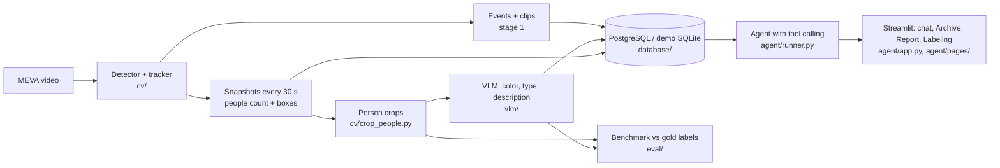

# Vision-based AI Assistant for Surveillance

A diploma project: a chat assistant that answers questions about surveillance video, such as
"Was there a person in a red sweater?" or "How many people were there at 90 seconds?".

## 1. Idea

The video is turned into a small, searchable archive, and the assistant answers questions from that archive:

1. **Video**: school camera recordings from the MEVA dataset (camera G421).
2. **People detection**: a detector counts people and gives their boxes. In stage 1 a tracker and zones also
   produce events (enter, approach a zone, and so on) with short clips.
3. **Snapshots**: one frame every 30 seconds, with the people count and boxes for each frame.
4. **VLM description**: every person crop goes to a vision-language model, which returns the clothing color, the
   clothing type and a short description from a closed vocabulary.
5. **Database**: events, snapshots and people go to PostgreSQL. The demo mode uses SQLite with test data.
6. **Agent**: a local LLM with tool calling picks a function (`search_by_clothing`, `count_people_at`,
   `query_events`, ...) and answers in the chat with times and frames.
7. **Web UI** (Streamlit): chat, an archive page, a report page and a labeling page.

## 2. Pipeline



## 3. Team

- **Saniya**: team lead; VLM part (model serving on the GPU server, prompts, clothing description) and the
  stage 3 VLM benchmark.
- **Aray**: computer vision. MEVA data, detection and tracking, events, snapshots, person crops and the
  non-VLM clothing methods.
- **Aigerim**: database, agent and front end. Schemas and loaders, agent tools, the Streamlit pages and the
  comparison of local LLMs for the agent.
- **Scientific advisor**: TODO (name).

## 4. Repository layout

| Folder | What is inside |
|---|---|
| `agent/` | Streamlit app (`app.py`), pages (`pages/1_Archive.py`, `2_Report.py`, `3_Labeling.py`), agent loop (`runner.py`), LLM client (`llm.py`), tools (`tools.py`, `snapshot_tools.py`, `tool_schemas.py`), demo SQLite database (`demo_db.py`) |
| `database/` | SQL schemas (`schema.sql`, `schema_snapshots.sql`, `schema_gold.sql`), loaders (`loader.py`, `snapshots_loader.py`, `gold_loader.py`), seed and demo data |
| `cv/` | MEVA download, tracking, zones, events, snapshots (`sample_snapshots.py`), person crops (`crop_people.py`), color histogram method (`color_hist.py`), track voting (`track_vote.py`) |
| `vlm/` | VLM prompts (`prompts.py`), describers (`describers/`: VLM API, SigLIP, PAR), server-side runner (`run_predictions.py`), vLLM server scripts (`server/`) |
| `eval/` | Tests, benchmarks and scoring (`score_methods.py`, `bench_clothing.py`, `bench_count.py`, `summarize_runs.py`, `summarize_counts.py`, `plot_height_accuracy.py`), agent evaluation (`eval_agent.py`, `compare_models.py`, `questions.csv`) |
| `eval/gold/`, `eval/gold_real/` | Gold labels from the labelers (see section 7) |
| `results/` | Outputs of the CV clothing methods (histogram, SigLIP) |
| `server_runs2/` | Stage 3 VLM runs on the GPU server: predictions, run log, summaries, plot |
| `docs/` | Plans, stack document, stage reports, runbooks (mostly in Russian) |
| `configs/` | `agent.example.env`: example environment for the agent |
| `demo_frames/` | Frames of the demo video used by the demo database |

## 5. Quick start

All commands run from the repository root. There is no pinned requirements file for the app yet (TODO).
The packages used below are `streamlit`, `pillow`, `scikit-learn` and `pytest`; `psycopg2-binary` is needed only
for PostgreSQL. CV code needs `cv/requirements.txt`.

### Demo mode (no database)

```bash
.venv/bin/python -m streamlit run agent/app.py
```

Open "Connection settings" on the page and choose **Demo (SQLite, test data)**. The demo database is built in
memory from `database/schema.sql`, `database/seed.sql` and `database/seed_snapshots.json`. If PostgreSQL is
selected and `DATABASE_URL` is not set, the agent tools fail.

### LLM through Ollama

The agent uses any OpenAI-compatible endpoint. The default (`agent/config.py`) is Ollama on `localhost`:

```bash
export LLM_BASE_URL=http://localhost:11434/v1
export LLM_MODEL=qwen2.5:7b
export LLM_API_KEY=EMPTY
```

The endpoint and model can also be changed in "Connection settings" on the page. Optional variables are
`LLM_MAX_TOKENS`, `LLM_TIMEOUT`, `DEFAULT_VIDEO_ID`, `CLIPS_ROOT` and `UI_THEME`. All of them are listed in
`configs/agent.example.env`.

### PostgreSQL mode

```bash
export DATABASE_URL=postgresql://<user>:<password>@localhost:5432/<db>
python -m database.snapshots_loader --init-schema && python -m database.snapshots_loader snapshots.json
```

The full loading steps for events, VLM descriptions, embeddings and gold tables are in
`docs/database_and_agent_tools.md`, `docs/stage2_snapshots.md` and `database/gold_loader.py`. PostgreSQL mode is
TODO: it was not verified end to end.

### Tests

```bash
.venv/bin/python -m eval.run_tests
```
```bash
.venv/bin/python -m pytest eval/test_stage3_vlm.py -q
```
```bash
python3 -m eval.test_cv_methods
```

- `eval.run_tests` covers the database, agent tools, agent, snapshots, gold, labeling, design and report. It
  first runs `eval.build`, which regenerates `eval/questions.csv` and the seed files.
- `test_stage3_vlm.py` covers the VLM benchmark code against a fake VLM server.
- `test_cv_methods` needs OpenCV and scikit-learn.

## 6. Stages

- **Stage 1: events.** MEVA download and ground truth, YOLO11s + ByteTrack, zones, events and clips (`cv/`).
  Clip descriptions were made with Qwen3-VL 4B on vLLM (prompts A and B). The stage also built the database
  schema and loader, six agent tools, 30 evaluation questions, and the Streamlit page with tool calling. See
  `docs/stack-document.md`, `docs/events_format.md`, `docs/database_and_agent_tools.md` and
  `docs/t11_agent_and_ui.md`.
- **Stage 2: snapshots.** A frame every 30 s from a 5-minute video (11 snapshots).
  - YOLO11s found 11 to 18 people per frame, 159 in total.
  - Qwen3-VL 4B described the clothing of every person: color, type and description.
  - The snapshots went to the `snapshots` and `snapshot_people` tables, with the agent tools
    `search_by_clothing`, `count_people_at` and `get_snapshot_summary` and the "Archive" page.
  - See `docs/stage2_results.md` and `docs/stage2_snapshots.md`.
- **Stage 3: VLM benchmark.** Four 4-bit VLMs were served with vLLM on a shared A10 GPU: Qwen3-VL 4B, Qwen3-VL 8B,
  Qwen3.5 4B and Gemma 3 4B.
  - Clothing per crop (mode R1, prompts A, B, C few-shot and D) and people counting per frame (modes R2–R4) were
    run on 303 person crops and 22 frames from two videos.
  - Results were scored against gold labels.
  - The stage also covers the CV clothing methods (color histogram, SigLIP), the labeling page, the report page
    and a benchmark of local LLMs for the agent.
  - See `docs/stage3_vlm_results.md` and `docs/stage3_runbook.md`.

Stage 3 is complete: VLM benchmark finished; see docs/stage3_vlm_results.md

## 7. Data

- The MEVA dataset is **not included** in the repository. Videos, frames, crops, clips and archives are listed
  in `.gitignore` (`data/`, `arai_data/`, `frames/`, `crops/`, `clips/`, `*.mp4`, `*.zip`). How to get the data:
  `cv/meva_fetch.py` and `docs/arai_stage3_howto.md`.
- Gold labels from the labelers are in the repository:
  - `eval/gold_real/gold_people_*.csv`: clothing color and type per person crop (Saniya, Aigerim, Aray);
  - `eval/gold_real/fewshot_examples.json`: the three crops used as few-shot examples, excluded from scoring;
  - `eval/gold/gold_frames_*.csv`: people count per frame;
  - `eval/gold/README.md`: labeling rules and file format;
  - `eval/gold/synthetic/`: synthetic fixtures for tests only.
