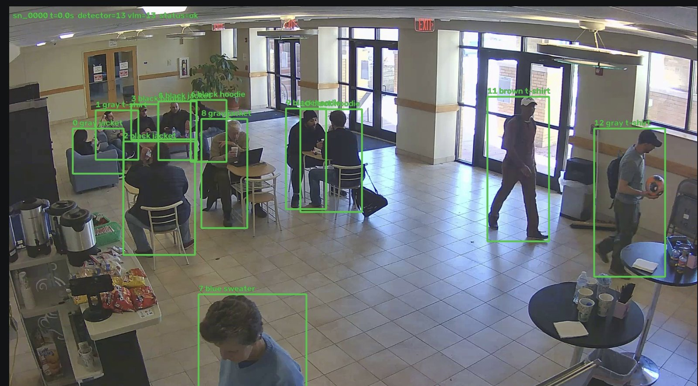
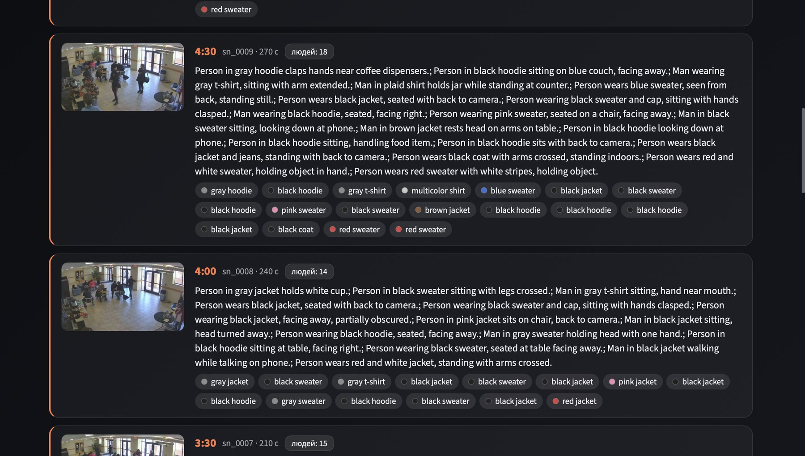
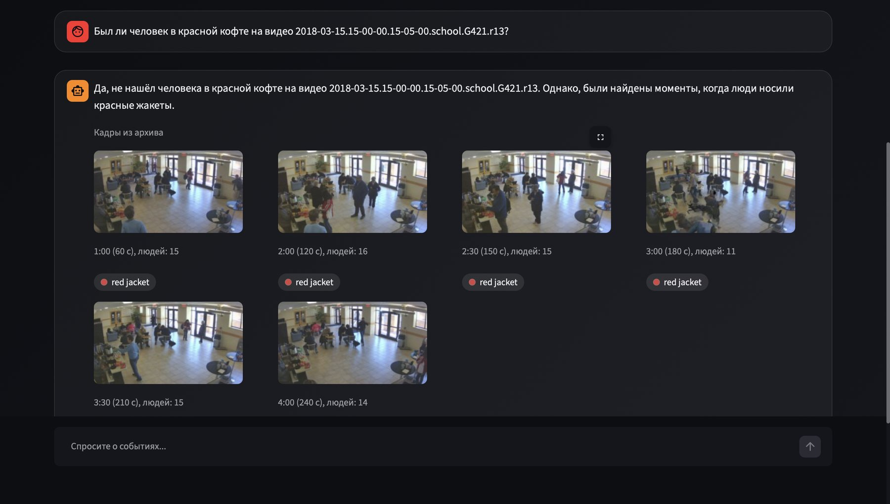

# Этап 2: срезы каждые 30 секунд, люди и одежда

Состояние на 16.11.2026. Задание научрука: брать кадр каждые 30 с из 5-минутного видео, считать людей, определять цвет и тип одежды, вести архив срезов, показать его на фронте и отвечать на вопросы вида «был ли человек в красной кофте?».

## Что сделано

- **Срезы:** 11 кадров (t = 0…300 с) из видео MEVA, камера G421, формат `snapshots.json` (кадр, число людей, рамки).
- **Люди:** YOLO11s считает людей на каждом срезе, от 11 до 18 человек на кадр, всего 159.
- **Одежда:** для каждой рамки вырезается кроп и отправляется в Qwen3-VL 4B (vLLM). На выходе цвет, тип, описание из закрытого словаря (есть `unknown`). 159 запросов за 64 секунды, ошибок нет, число людей совпало с детектором на всех срезах.
- **База:** таблицы `snapshots` и `snapshot_people` (PostgreSQL), загрузчик `snapshots.json` и `vlm/snapshots_vlm.json`.
- **Агент:** функции `search_by_clothing`, `count_people_at`, `get_snapshot_summary`.
- **Фронт:** раздел «Архив событий» (Streamlit): сетка срезов, превью, число людей, цветные теги одежды, фильтры по цвету и типу.

## Как устроено

```
видео → срезы каждые 30 с (кадры) → YOLO11s (people_count, boxes)
      → кроп на каждую рамку → Qwen3-VL 4B (цвет, тип, описание)
      → snapshots_vlm.json → PostgreSQL (snapshots, snapshot_people)
      → агент (search_by_clothing, count_people_at) → Streamlit («Архив событий», ассистент)
```

## Кто что делал

| | Этап 1 | Этап 2 |
|---|---|---|
| **Арай** (CV) | загрузка MEVA и разметки; YOLO11s + ByteTrack, зоны; события 1–5, клипы, сверка с MEVA | срезы каждые 30 с (`sample_snapshots.py`); подсчёт людей и рамки; `snapshots.json` |
| **Сания** (VLM, сервер) | формат `events.json`, stack-document; vLLM + Qwen3-VL 4B на GPU-сервере; описание 23 клипов (prompt A и B) | одежда по кропам (159 людей); prompt и словарь цветов/типов; сквозной прогон и бонусный вопрос |
| **Айгерим** (БД, агент, фронт) | схема БД, загрузчик `events.json`; 6 функций агента, 30 eval-вопросов; Streamlit + tool calling | таблицы `snapshots`, `snapshot_people`, загрузчик; `search_by_clothing`, `count_people_at`; фронт «Архив событий» |

## Результаты

| Метрика | Значение |
|---|---|
| Срезов в архиве | 11 (t = 0…300 с, шаг 30 с) |
| Людей на срез | от 11 до 18, максимум 18 на 270 с |
| Всего людей с описанием одежды | 159 |
| VLM-запросов (кропов) | 159, ошибок 0 |
| Время прогона | 64 с |
| Совпадение числа людей VLM и YOLO | 11 из 11 срезов |
| Доля цвета `black` | около 60% (96 из 159) |

## Скриншоты

**Проверочная картинка (`annotate_snapshots.py`): рамки, цвет и тип у каждого человека**



**Раздел «Архив событий»: превью, число людей, теги одежды**



**Ассистент: вопрос про красную кофту (известная проблема с формулировкой ответа, см. ниже)**



## Как запустить (кратко)

Подробности смотри в `vlm/README_snapshots.md` и `docs/t11_agent_and_ui.md`.

1. **VLM** (нужен запущенный vLLM с `qwen3-vl-4b` на `127.0.0.1:8765`):
   `python vlm/batch_describe_snapshots.py snapshots.json . snapshots_vlm.json --workers 4`
2. **Проверка картинками:** `python vlm/annotate_snapshots.py snapshots_vlm.json . --out annotated`
3. **Загрузка в базу:** `python -m database.snapshots_loader snapshots_vlm.json`
   Важно: сначала загрузить `snapshots.json` от Арай, потом `snapshots_vlm.json`. В файле Арай `"people": []`, и при обратном порядке люди в базе обнуляются.
4. **Приложение (Streamlit):** на странице «Настройки подключения» выбрать «PostgreSQL (DATABASE_URL)» (по умолчанию стоит демо-режим с тестовыми данными), в «Архиве» выбрать видео `2018-03-15.15-00-00.15-05-00.school.G421.r13`. В вопросах ассистенту пока нужно указывать название видео.

## Ограничения и известные проблемы

- **Цвета.** Определяются верно примерно у половины проверенных людей. Модель смещается в чёрный и серый, бордовая футболка и бежевая куртка определились неточно (ложное «нет» на вопросы про них). Нестабильность: одна и та же бежевая куртка на разных срезах получила разные цвета.
- **Бонусный вопрос** «был ли человек в красной кофте?»: данные в базе верные (красный свитер на 270 и 300 с), но модель агента (Qwen2.5-7B) иногда подменяет «кофту» на «куртку» и пишет противоречивый текст.
- **Видео по умолчанию** в агенте: если не указать видео в вопросе, подставляется `test_video_01`.
- **Дубли рамок** детектора на отдельных срезах (двойная детекция одного человека).
- **PostgreSQL** проверен на локальной базе, на общей командной не проверялся.
- `person_idx` относится только к срезу и не связан с `track_id` из этапа 1.

## Дальше

- Уточнить промпт цветов (бордовое, бежевое, тёмно-синее), расширить словарь цветов (например, `dark blue`, `dark red`).
- Формировать ответ «да/нет» кодом по результату поиска, а не языковой моделью.
- Задать видео по умолчанию, чтобы не указывать его в каждом вопросе.
- Прогнать на втором видео.

## Данные и лицензия

Видео и кадры из набора MEVA (CC-BY-4.0), камера G421.
