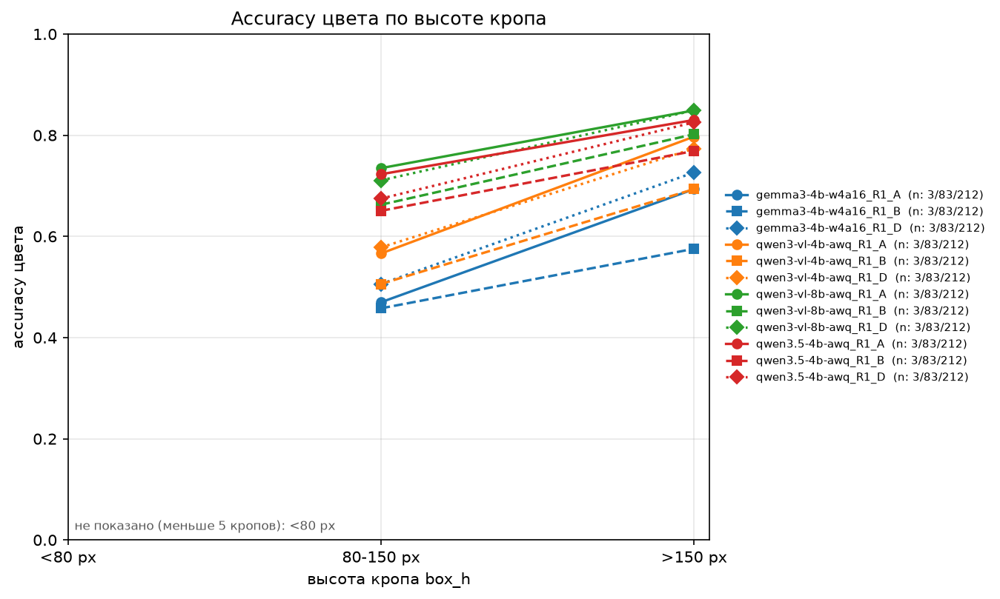

# Этап 3: бенчмарк VLM. Результаты прогонов

> **Статус:** прогоны на сервере сделаны 25.11.2026 на наборе Арай (кропы и кадры двух видео, см. стенд). Файлы лежат в
> `server_runs2/`. **Эталон по счёту людей есть** (22 кадра, разметчики Saniya и Aigerim), поэтому в разделе 5 есть MAE.
> **Эталон по одежде размечен одним разметчиком** (Saniya, `eval/gold_real/gold_people_saniya.csv`), поэтому точность
> цвета и типа в разделе 6 предварительная. Победителя этот отчёт не называет (см. разделы 5.4 и 6.4).
> Источники цифр:
> - `server_runs2/summary_runs.csv` и `.md` (`python3 -m eval.summarize_runs --dir server_runs2`);
> - `server_runs2/count_vs_gold.md` (`eval.score_methods count`);
> - `server_runs2/count_summary.md` (`eval.summarize_counts`);
> - `server_runs2/clothing_vs_gold.md` (`eval.score_methods people`) и `server_runs2/height_accuracy.png` (`eval.plot_height_accuracy`).

**Главный вопрос этапа:** какая связка (модель + режим + промпт) лучше всего отвечает по кадру, сколько людей и во что
они одеты, и сколько это стоит в секундах и памяти.

## 1. Стенд
- **Сервер:** общий, 2×A10 (по 23 GB). Нам доступно около 11.4 GiB на GPU 1: рядом работает чужой процесс, он держит около 10.5 GiB.
- **Софт:** vLLM 0.34.0, transformers 5.22.2, torch 2.14.0.
- **Данные:** набор Арай (`cv/crop_people.py`), только рамки с `kept=true` (без дублей, слишком мелких и битых рамок).
  | видео | у Арай | кропов (R1) | кадров (R2–R4) |
  |---|---|---|---|
  | `2018-03-15.15-00-00.15-05-00.school.G421.r13` | video1 | 156 | 11 |
  | `2018-03-07.17-35-00.17-40-00.school.G421.r13` | video2 | 147 | 11 |
  | всего | | 303 | 22 |

  Номера срезов `sn_0000…sn_0010` повторяются в обоих видео, поэтому ключ везде `(video_id, snapshot_id, person_idx)`.
- **Запросы:** temperature 0, у всех режимов 2 параллельных запроса (`workers 2` в `runs.jsonl`). У V3 thinking выключен
  (`--disable-thinking`). `max_tokens` и штрафы не задавались, кроме прогонов `R3_rep1.1` (`--repetition-penalty 1.1`).
- **Журнал прогонов.** В `runs.jsonl` по строке на видео, поэтому каждый прогон записан дважды. Это не дубль.
  - V2 R4 запускался два раза. Первый прогон (10:13, 0.68 с) упал: `Connection refused`, error на всех 22 кадрах.
    Причина: обрыв ssh, после которого сервер V2 перезапускали (см. раздел 3).
  - Файл `count_qwen3-vl-8b-awq_R4.jsonl` перезаписан вторым прогоном (11:07), в нём 22 из 22 ok.
  - `summarize_runs` берёт для каждого файла последний прогон по `started_at`, а старый выводит в stderr как «не учтён».

## 2. Модели и чекпоинты
| слот | чекпоинт | квантование | имя в vLLM (`--served-model-name`) |
|---|---|---|---|
| V1 | `cpatonn/Qwen3-VL-4B-Instruct-AWQ-4bit` | AWQ 4 бит | `qwen3-vl-4b-awq` |
| V2 | `cpatonn/Qwen3-VL-8B-Instruct-AWQ-4bit` | AWQ 4 бит | `qwen3-vl-8b-awq` |
| V3 | `cyankiwi/Qwen3.5-4B-AWQ-4bit` | AWQ 4 бит | `qwen3.5-4b-awq` |
| V4 | `RedHatAI/gemma-3-4b-it-quantized.w4a16` | GPTQ W4A16 | `gemma3-4b-w4a16` |

Все чекпоинты 4-битные. bf16 на общей карте не помещается. Это измерено на V1: на старт нужно около 11.5 GiB, а доступно 11.38 GiB.
В логах vLLM у всех четырёх стоит `quantization=compressed-tensors`: в этом формате vLLM загружает и AWQ-, и GPTQ-веса.

## 3. Конфиги vLLM и память на этом наборе
Источник: команды запуска и логи `server_runs2/vllm_*.log` (строка `non-default args`). Для V1 лога в `server_runs2/` нет,
его настройки взяты из команды запуска.

| слот | `--gpu-memory-utilization` | `--max-model-len` | `--max-num-batched-tokens` | `--max-num-seqs` | размер картинки | прочее |
|---|---|---|---|---|---|---|
| V1 | 0.48 | 8192 | 8192 | 8 | без ограничения | `--enforce-eager`, `--limit-mm-per-prompt '{"image": 1}'` |
| V2 | 0.50 | 4096 | 2048 | 4 | `--mm-processor-kwargs` size: shortest_edge 65536, longest_edge 2359296 (до 2.36 млн пикселей) | `--enforce-eager`, `--limit-mm-per-prompt '{"image": 1}'` |
| V3 | 0.50 | 4096 | 2048 | 4 | как у V2 | как у V2; запросы с `--disable-thinking` |
| V4 | 0.48 | 4096 | 4096 (значение по умолчанию скрипта) | 4 | без ограничения (Gemma сама сжимает кадр до 896×896) | `--enforce-eager`, `--limit-mm-per-prompt '{"image": 1}'` |

**Перезапуск V2.** V2 перезапускали один раз: после обрыва ssh первый прогон R4 получил `Connection refused`.
- `count_qwen3-vl-8b-awq_R4.jsonl` и `count_qwen3-vl-8b-awq_R3_rep1.1.jsonl` записаны с повторного запуска.
- Все остальные файлы V2 (R1 A/A_repeat2/B/D, R2, R3) записаны с первого запуска.
- В `server_runs2/` лежит только лог повторного запуска (`vllm_v2_restart.log`), поэтому память V2 ниже взята из него.

Память по логам vLLM, GiB: веса (строка «Model loading took») и KV-кэш («Available KV cache memory»).
| слот | веса, GiB | KV-кэш, GiB | полная VRAM на GPU 1 |
|---|---|---|---|
| V1 | 4.26 | нет | не измерена |
| V2 | 7.2 | 3.45 | ≈10056 MiB (nvidia-smi: 20997 − 10941 MiB соседа) |
| V3 | 3.83 | 6.79 | не измерена |
| V4 | 4.18 | 5.88 | не измерена |

- **V1:** вес 4.26 GiB взят из лога другой конфигурации (`max-model-len` / `max-num-batched-tokens` 4096). Финальный
  прогон шёл с 8192, его лога нет, поэтому KV-кэша для него нет.
- Полная VRAM измерена только у V2. У V3 и V4 известны только веса + KV по логам. Сверху их ограничивает
  `--gpu-memory-utilization` (0.50 и 0.48 от 22.06 GiB, то есть около 11.0 и 10.6 GiB).
- KV-кэш зависит от выставленного бюджета: vLLM занимает под KV всё, что остаётся в бюджете после весов и активаций.
  Это **не минимально необходимая** память.

## 4. Скорость и стабильность (без эталона)
Секунды считаются на один запрос при 2 параллельных запросах на общей карте. Доли ok / truncated / ошибка в сумме
дают 100 %. Все файлы этого набора в новом формате: truncated и suspicious записаны. Цифры по каждому видео отдельно
лежат в `server_runs2/summary_runs.csv`.

### 4.1. Одежда, R1 (303 кропа на прогон, у всех 100 % ok, 0 truncated, 0 ошибок)
| слот | промпт | сек ср. | сек p95 | доля black: video1 / video2 / вместе | unknown цвет | unknown тип | повтор: цвет / тип / цвет+тип |
|---|---|---|---|---|---|---|---|
| V1 | A | 1.49 | 1.64 | 59.0 % / 45.6 % / 52.5 % | 1.0 % | 1.0 % | 100 % / 100 % / 100 % |
| V1 | B | 4.66 | 5.72 | 66.7 % / 52.4 % / 59.7 % | 3.6 % | 1.0 % | — |
| V1 | D | 2.21 | 2.34 | 63.5 % / 52.4 % / 58.1 % | 0.7 % | 1.3 % | — |
| V2 | A | 1.73 | 2.15 | 60.3 % / 33.3 % / 47.2 % | 0.7 % | 0.7 % | 100 % / 100 % / 100 % |
| V2 | B | 4.51 | 5.57 | 63.5 % / 38.8 % / 51.5 % | 1.0 % | 1.0 % | — |
| V2 | D | 2.42 | 2.76 | 60.3 % / 36.0 % / 48.5 % | 0 % | 0.3 % | — |
| V3 | A | 1.77 | 2.02 | 59.6 % / 38.1 % / 49.2 % | 0 % | 0 % | 99.7 % / 99.7 % / 99.3 % |
| V3 | B | 4.52 | 5.74 | 64.7 % / 46.3 % / 55.8 % | 0 % | 0 % | — |
| V3 | D | 2.39 | 2.59 | 60.9 % / 40.8 % / 51.2 % | 0 % | 0 % | — |
| V4 | A | 3.14 | 3.33 | 53.8 % / 39.5 % / 46.9 % | 0 % | 0 % | 100 % / 100 % / 100 % |
| V4 | B | 6.63 | 8.57 | 42.9 % / 30.6 % / 37.0 % | 16.2 % | 1.3 % | — |
| V4 | D | 4.33 | 4.60 | 59.6 % / 46.9 % / 53.5 % | 0 % | 0 % | — |

- Повтор посчитан только для промпта A: второй проход по тем же 303 кропам (`*_R1_A_repeat2.jsonl`).
  - Пары сопоставлены по `(video_id, snapshot_id, person_idx)`.
  - У V3 на video1 разошлись 2 из 156 человек (повтор цвет+тип 98.7 %), на video2 разошёлся 0.
- Промпт C (few-shot) запускался только на V2 (qwen3-vl-8b-awq), см. раздел 6.2.
- Доли black и unknown посчитаны среди ответов модели. Хорошо это или плохо, станет ясно только при сравнении с эталоном по кропам.

### 4.2. Счёт людей, R2 / R3 / R4 (22 кадра на прогон, по 11 на видео)
| слот | режим | штраф | ok | truncated | ошибка | suspicious | сек ср. | сек p95 | людей ср. (мин–макс), по ok-кадрам |
|---|---|---|---|---|---|---|---|---|---|
| V1 | R2 | — | 22/22 | 0 | 0 | 0 | 1.59 | 1.70 | 13.4 (12–14) |
| V1 | R3 | — | 3/22 | 19/22 | 0 | 0 | 38.3 | 41.5 | 13.3 (12–14), по 3 кадрам |
| V1 | R4 | — | 22/22 | 0 | 0 | 4 | 20.3 | 26.5 | 10.7 (0–14) |
| V2 | R2 | — | 22/22 | 0 | 0 | 0 | 2.12 | 2.16 | 14.1 (11–17) |
| V2 | R3 | — | 7/22 | 15/22 | 0 | 0 | 33.1 | 42.2 | 11.0 (10–13), по 7 кадрам |
| V2 | R3 | rep1.1 | 22/22 | 0 | 0 | 0 | 16.1 | 19.9 | 9.6 (6–13) |
| V2 | R4 | — | 22/22 | 0 | 0 | 0 | 21.1 | 22.8 | 12.8 (11–14) |
| V3 | R2 | — | 22/22 | 0 | 0 | 0 | 1.41 | 1.45 | 12.9 (12–14) |
| V3 | R3 | — | 21/22 | 1/22 | 0 | 0 | 20.1 | 24.2 | 13.3 (12–18), по 21 кадру |
| V3 | R3 | rep1.1 | 22/22 | 0 | 0 | 0 | 16.4 | 18.9 | 11.9 (6–14) |
| V3 | R4 | — | 22/22 | 0 | 0 | 0 | 27.6 | 31.8 | 13.7 (11–17) |
| V4 | R2 | — | 22/22 | 0 | 0 | 0 | 1.05 | 1.08 | 12.1 (9–17) |
| V4 | R3 | — | 16/22 | 6/22 | 0 | 0 | 40.6 | 71.5 | 12.3 (9–20), по 16 кадрам |
| V4 | R3 | rep1.1 | 22/22 | 0 | 0 | 0 | 27.9 | 36.0 | 8.5 (5–11) |
| V4 | R4 | — | 22/22 | 0 | 0 | 0 | 31.8 | 38.1 | 11.8 (9–14) |

- «Штраф rep1.1» — это прогон с `--repetition-penalty 1.1`.
- R3 со штрафом 1.1 у qwen3-vl-4b-awq (V1) не считали: у всех трёх остальных моделей штраф занижает счёт (см. 5.3).
  Сравнение R3 и R3_rep1.1 делаем по трём моделям: V2, V3, V4.
- **V1 R4, suspicious 4.** На кадрах video1 `sn_0006` и video2 `sn_0003`, `sn_0009`, `sn_0010` модель ответила
  `{"people_count": 0, "people": []}` со статусом ok, хотя рамок детектора на них 11–14. Отсюда минимум 0.
  В метриках раздела 5 эти кадры не учитываются.
- **R3 без штрафа** на людных кадрах зацикливается: модель повторяет одного и того же человека, пока ответ не упрётся
  в лимит токенов. Сильнее всего это у V1 (19/22 truncated) и V2 (15/22).

## 5. Счёт людей против эталона
Эталон: `eval/gold/gold_frames_*.csv`. Saniya и Aigerim разметили все 22 кадра, файл Aray пустой.
Правило эталона взято из `eval.score_methods`:
- при нескольких разметчиках берётся нижняя медиана; при двух разметчиках это меньшее из двух чисел;
- VLM-ответ учитывается, только если `status=ok`, нет флага `suspicious` и `people_count` не пустой.

Полные таблицы по кадрам: `server_runs2/count_vs_gold.md` и `server_runs2/count_summary.md`.

### 5.1. Потолок: разметчики между собой
| видео | кадров | разошлись | MAE между разметчиками |
|---|---|---|---|
| video1 (03-15) | 11 | 4 | 0.36 |
| video2 (03-07) | 11 | 7 | 1.45 |
| вместе | 22 | 11 | 0.91 |

- В среднем Saniya ставит на 0.55 человека больше, чем Aigerim.
- Самые большие расхождения на video2:
  - `sn_0009`: 12 против 16;
  - `sn_0004`: 13 против 16.
- Список всех 11 кадров с видео и обоими числами есть в `count_summary.md`, раздел «в».

Эталон «меньшее из двух» сам по себе смещён вниз относительно второго разметчика. Поэтому модели, которые недосчитывают,
выглядят по нему чуть лучше, чем по среднему двух разметчиков.

### 5.2. MAE / доля точных / смещение со знаком (в скобках число учтённых кадров)
Минус = модель теряет людей, плюс = лишние.
| метод | video1 | video2 | вместе |
|---|---|---|---|
| YOLO сырой (`people_count`) | 1.00 / 9 % / −0.09 (11) | 1.45 / 27 % / +0.55 (11) | 1.23 / 18 % / +0.23 (22) |
| YOLO без дублей рамок | 0.91 / 27 % / −0.36 (11) | 1.18 / 27 % / +0.09 (11) | 1.05 / 27 % / −0.14 (22) |
| V1 R2 | 1.36 / 18 % / −1.00 (11) | 0.36 / 73 % / +0.00 (11) | 0.86 / 45 % / −0.50 (22) |
| V1 R3 | 3.50 / 0 % / −3.50 (2) | 1.00 / 0 % / +1.00 (1) | 2.67 / 0 % / −2.00 (3) |
| V1 R4 | 1.80 / 20 % / −1.80 (10) | 0.88 / 38 % / −0.12 (8) | 1.39 / 28 % / −1.06 (18) |
| V2 R2 | 1.00 / 18 % / −0.64 (11) | 1.18 / 9 % / +1.00 (11) | 1.09 / 14 % / +0.18 (22) |
| V2 R3 | 3.50 / 0 % / −3.50 (4) | 3.33 / 0 % / −3.33 (3) | 3.43 / 0 % / −3.43 (7) |
| V2 R3 rep1.1 | 5.09 / 0 % / −4.91 (11) | 3.64 / 0 % / −3.64 (11) | 4.36 / 0 % / −4.27 (22) |
| V2 R4 | 1.55 / 18 % / −1.55 (11) | 1.00 / 27 % / −0.64 (11) | 1.27 / 23 % / −1.09 (22) |
| V3 R2 | 1.64 / 18 % / −1.45 (11) | 0.73 / 55 % / −0.55 (11) | 1.18 / 36 % / −1.00 (22) |
| V3 R3 | 1.60 / 20 % / −0.80 (10) | 0.73 / 36 % / −0.18 (11) | 1.14 / 29 % / −0.48 (21) |
| V3 R3 rep1.1 | 3.09 / 9 % / −3.09 (11) | 1.09 / 36 % / −0.91 (11) | 2.09 / 23 % / −2.00 (22) |
| V3 R4 | 0.82 / 36 % / −0.27 (11) | 0.82 / 45 % / −0.09 (11) | 0.82 / 41 % / −0.18 (22) |
| V4 R2 | 3.27 / 0 % / −3.09 (11) | 1.00 / 36 % / −0.45 (11) | 2.14 / 18 % / −1.77 (22) |
| V4 R3 | 3.83 / 0 % / −1.17 (6) | 1.50 / 20 % / −0.90 (10) | 2.38 / 12 % / −1.00 (16) |
| V4 R3 rep1.1 | 5.91 / 0 % / −5.91 (11) | 5.00 / 0 % / −5.00 (11) | 5.45 / 0 % / −5.45 (22) |
| V4 R4 | 3.27 / 9 % / −3.27 (11) | 1.36 / 18 % / −1.00 (11) | 2.32 / 14 % / −2.14 (22) |

- Строки, где учтено меньше 22 кадров (R3 без штрафа, V1 R4), посчитаны на других кадрах. Сравнивать их MAE с
  остальными напрямую нельзя.
- Колонка «вместе» совпадает с выводом `eval.score_methods count` (`count_vs_gold.md`).

### 5.3. R3: штраф за повторы против прогона без штрафа
Только V2, V3 и V4: у V1 (qwen3-vl-4b-awq) R3 со штрафом не запускали (см. 4.2).

| слот | ok без штрафа | ok с rep1.1 | кадров ok в обоих | сдвиг счёта (rep1.1 − без), на общих кадрах |
|---|---|---|---|---|
| V2 | 7/22 | 22/22 | 7 | −1.86 |
| V3 | 21/22 | 22/22 | 21 | −1.43 |
| V4 | 16/22 | 22/22 | 16 | −4.12 |

Штраф убирает обрывы: у всех трёх моделей 22/22 ok. Но счёт со штрафом ниже, чем без него, на тех же кадрах. По эталону
MAE со штрафом выше: V2 4.36, V3 2.09, V4 5.45. Без штрафа MAE V2 3.43, V3 1.14, V4 2.38, но эти числа посчитаны на
меньшем числе кадров.

### 5.4. Почему здесь нет победителя
- 22 кадра из одной школьной камеры — это мало.
- Разница между лучшими строками таблицы 5.2 (MAE 0.82–1.09) меньше или того же порядка, что расхождение самих
  разметчиков (MAE 0.91, на video2 1.45).
- На двух видео порядок методов разный. Например, V1 R2 на video2 MAE 0.36, а на video1 1.36.
- Эталон «меньшее из двух» смещён вниз (см. 5.1).

Выводов о лучшей модели или режиме по этим цифрам не делаем.

## 6. Одежда (R1) против эталона
Эталон: `eval/gold_real/gold_people_saniya.csv`, 303 кропа, **один разметчик (Saniya)**. Кропы с visible = «не видно»
(2 шт.) и 3 few-shot примера не оцениваются, поэтому n = 298 у всех методов. Полная таблица (macro-F1, top-2, unknown,
black, тип) лежит в `server_runs2/clothing_vs_gold.md`:
```bash
python3 -m eval.score_methods people --gold "eval/gold_real/gold_people_*.csv" --pred "server_runs2/flat/*.jsonl" --exclude-file eval/gold_real/fewshot_examples.json --out-md server_runs2/clothing_vs_gold.md
```

### 6.1. Accuracy цвета и типа (n = 298)
| слот | промпт | accuracy цвета | accuracy типа | сек/кроп |
|---|---|---|---|---|
| V1 | A | 0.732 | 0.513 | 1.49 |
| V1 | B | 0.641 | 0.473 | 4.67 |
| V1 | D | 0.718 | 0.550 | 2.21 |
| V2 | A | 0.815 | 0.587 | 1.73 |
| V2 | B | 0.762 | 0.463 | 4.51 |
| V2 | C (few-shot) | 0.789 | 0.537 | 1.61 |
| V2 | D | 0.809 | 0.564 | 2.42 |
| V3 | A | 0.799 | 0.527 | 1.77 |
| V3 | B | 0.735 | 0.507 | 4.52 |
| V3 | D | 0.782 | 0.540 | 2.39 |
| V4 | A | 0.631 | 0.460 | 3.14 |
| V4 | B | 0.544 | 0.413 | 6.63 |
| V4 | D | 0.664 | 0.433 | 4.33 |

### 6.2. P-C (few-shot) на V2
- **Как устроен запрос:** 3 примера (кроп + правильный JSON-ответ), затем целевой кроп. Всего 4 картинки на запрос.
- **Примеры** (video1, `2018-03-15.15-00-00.15-05-00.school.G421.r13`), список в `eval/gold_real/fewshot_examples.json`:
  - `sn_0004_p14`: blue jacket;
  - `sn_0004_p10`: red jacket;
  - `sn_0000_p12`: gray t-shirt.
- **Исключение из оценки.** Эти 3 кропа исключены у всех методов (`--exclude-file`), поэтому n = 298.
- **Прогон.** 26.11.2026, 303 из 303 ok.
- **Результат:** accuracy цвета 0.789, accuracy типа 0.537, 1.61 с на кроп. Это не лучше промптов A (0.815) и D (0.809)
  той же модели.

### 6.3. Точность цвета и высота кропа
Бакеты по `box_h`: <80 px (n = 3), 80–150 px (n = 83), >150 px (n = 212). График (бакет <80 не нарисован, в нём 3 кропа):
`server_runs2/height_accuracy.png`



| слот | промпт | 80–150 px | >150 px |
|---|---|---|---|
| V1 | A / B / D | 0.566 / 0.506 / 0.578 | 0.797 / 0.693 / 0.774 |
| V2 | A / B / C / D | 0.735 / 0.663 / 0.699 / 0.711 | 0.849 / 0.802 / 0.825 / 0.849 |
| V3 | A / B / D | 0.723 / 0.651 / 0.675 | 0.830 / 0.769 / 0.825 |
| V4 | A / B / D | 0.470 / 0.458 / 0.506 | 0.693 / 0.575 / 0.726 |

- У всех 13 методов accuracy на кропах >150 px выше, чем на 80–150 px. Разница от 0.11 (V3 A) до 0.23 (V1 A).
- В бакете <80 px у всех 0.667, но это 2 из 3 кропов: выводов по нему нет.

### 6.4. Повторяемость и почему нет победителя
- **Повторяемость A против A_repeat2** (`server_runs2/summary_runs.md`, пары по `(video_id, snapshot_id, person_idx)`):
  - у V1, V2 и V4 на обоих видео совпадают 100 % цветов и типов;
  - у V3 на video1 цвет 0.994, тип 0.994, цвет+тип 0.987 (разошлись 2 из 156 человек), на video2 100 %.
  - При temperature 0 это проверка детерминизма сервера, а не устойчивости модели.
- **Почему победителя нет.**
  - Эталон пока одного разметчика: потолка согласия людей по одежде нет.
  - Доверительный интервал accuracy при n = 298 около ±4.5 п.п. Верхние строки таблицы 6.1 (V2 A 0.815, V2 D 0.809,
    V3 A 0.799, V2 C 0.789) отличаются меньше этого.
  - Победителя по одежде не называем.

## 7. Ограничения
- **(а)** Все чекпоинты 4-битные: результаты относятся к квантованным моделям, а не к исходным bf16. У V4 другой формат квантования (GPTQ W4A16, у остальных AWQ), поэтому V4 сравнивается с остальными не на равных.
- **(б)** У V2 и V3 размер картинки ограничен (до 2.36 млн пикселей). Gemma (V4) сама сжимает кадр до 896×896. Мелкие люди на кадре при этом теряют детали.
- **(в)** Повторяемость при temperature 0 проверяет детерминизм сервера (одинаковый ли ответ на одинаковый запрос), а не устойчивость модели к шуму или другому кадру.
- **(г)** Сервер общий: секунды зависят от чужой нагрузки, это ориентир, а не точное значение.
- **(д)** Счёт людей: 22 кадра, два разметчика разошлись на 11 из 22 (см. 5.1 и 5.4).
- **(е)** R4 даёт модели только рамки `kept=true` от Арай. Ошибки детектора и дедупликации переходят в подсказку.
- **(ж)** Какой чекпоинт использовался на этапе 2, не установлено.
- **(з)** Для V1 на этом наборе нет лога vLLM: настройки взяты из команды запуска, память — значения этапа 2 (см. раздел 3).

Общие ограничения методики (из плана этапа):
- Эталон будет малым (одна школьная камера MEVA), поэтому выводы не переносятся на другие сцены.
- Словарь цветов не расширялся: `navy`→`blue`, `maroon`→`red` и т. п. скрывают различия. Доля `black` особенно чувствительна.
- P-B делает второй запрос без картинки, другие варианты «двух шагов» не проверялись.
- R4 даёт модели рамки детектора: если детектор ошибся, подсказка может навредить.

## 8. Воспроизведение
Без токенов и паролей. V4 (Gemma) закрыт лицензией: вход в Hugging Face делаешь сама.
Подготовка и копирование файлов на сервер описаны в `docs/stage3_runbook.md`, раздел 0.

**Окружение** (на сервере, перед каждым запуском vLLM):
```bash
source ~/work/venv/bin/activate && cd ~/work
```
```bash
export CUDA_VISIBLE_DEVICES=1 HF_HOME=~/work/hf_cache XDG_CACHE_HOME=~/work/cache VLLM_USE_FLASHINFER_SAMPLER=0
```

**Сервер vLLM.** Команды V2–V4 собраны из строки `non-default args` в логах `server_runs2/vllm_*.log`, V1 — из команды запуска (лога нет).
Модели поднимаются строго по одной, перед каждой нужно проверить место (`bash vlm/server/check_gpu.sh`).

V1 (лога нет, команда запуска на этом наборе):
```bash
vllm serve cpatonn/Qwen3-VL-4B-Instruct-AWQ-4bit --served-model-name qwen3-vl-4b-awq --port 8765 --max-model-len 8192 --gpu-memory-utilization 0.48 --limit-mm-per-prompt '{"image": 1}' --max-num-seqs 8 --max-num-batched-tokens 8192 --enforce-eager
```
V2:
```bash
vllm serve cpatonn/Qwen3-VL-8B-Instruct-AWQ-4bit --served-model-name qwen3-vl-8b-awq --port 8765 --max-model-len 4096 --gpu-memory-utilization 0.50 --limit-mm-per-prompt '{"image": 1}' --mm-processor-kwargs '{"size": {"shortest_edge": 65536, "longest_edge": 2359296}}' --max-num-seqs 4 --max-num-batched-tokens 2048 --enforce-eager
```
V3:
```bash
vllm serve cyankiwi/Qwen3.5-4B-AWQ-4bit --served-model-name qwen3.5-4b-awq --port 8765 --max-model-len 4096 --gpu-memory-utilization 0.50 --limit-mm-per-prompt '{"image": 1}' --mm-processor-kwargs '{"size": {"shortest_edge": 65536, "longest_edge": 2359296}}' --max-num-seqs 4 --max-num-batched-tokens 2048 --enforce-eager
```
V4:
```bash
vllm serve RedHatAI/gemma-3-4b-it-quantized.w4a16 --served-model-name gemma3-4b-w4a16 --port 8765 --max-model-len 4096 --gpu-memory-utilization 0.48 --limit-mm-per-prompt '{"image": 1}' --max-num-seqs 4 --max-num-batched-tokens 4096 --enforce-eager
```

**Раннер** (во втором окне, когда сервер готов). Набор Арай лежит на сервере в `~/work/data/crops2/video{1,2}/`, кадры
video1 в `~/work/data/frames`, video2 в `~/work/data/video2_frames/frames`. Команды собраны из `server_runs2/run_v*_all.sh`.
`M` — это имя из `--served-model-name`. У V3 к каждой команде добавь `--disable-thinking`.
```bash
cd ~/work/vlm; M=qwen3-vl-4b-awq; D=~/work/data/crops2; C="$D/video1/video1_crops_index.json $D/video2/video2_crops_index.json"; F="$D/video1/video1_frames_index.json $D/video2/video2_frames_index.json"; FD="--frames-dir $HOME/work/data $HOME/work/data/video2_frames"
```
R1, промпт A, два прохода (второй нужен для повторяемости):
```bash
python3 run_predictions.py crops --crops-index $C --model $M --variant A --repeat 2 --out ~/work/runs2/pred_clothing_${M}_R1_A.jsonl
```
R1, промпты B и D:
```bash
python3 run_predictions.py crops --crops-index $C --model $M --variant B --out ~/work/runs2/pred_clothing_${M}_R1_B.jsonl
```
```bash
python3 run_predictions.py crops --crops-index $C --model $M --variant D --out ~/work/runs2/pred_clothing_${M}_R1_D.jsonl
```
Счёт R2, R3, R4:
```bash
for R in R2 R3 R4; do python3 run_predictions.py count --mode $R --frames-index $F $FD --crops-index $C --model $M --out ~/work/runs2/count_${M}_${R}.jsonl; done
```
R3 со штрафом за повторы (V2, V3, V4):
```bash
python3 run_predictions.py count --mode R3 --repetition-penalty 1.1 --frames-index $F $FD --crops-index $C --model $M --out ~/work/runs2/count_${M}_R3_rep1.1.jsonl
```

**После модели:** останови vLLM и убери кэши этой модели (`bash vlm/server/cleanup.sh <репозиторий>`, подтверждение `yes`).

**На Mac:**
```bash
scp -r <ПОЛЬЗОВАТЕЛЬ>@<СЕРВЕР>:~/work/runs2 ./server_runs2
```
```bash
python3 -m eval.summarize_runs --dir server_runs2 --out server_runs2/summary_runs.csv
```
```bash
python3 -m eval.score_methods count --gold eval/gold/gold_frames_*.csv --frames-index arai_data/video*/video*_frames_index.json --vlm-counts "server_runs2/count_*.jsonl" --out-md server_runs2/count_vs_gold.md
```
```bash
python3 -m eval.summarize_counts --gold eval/gold/gold_frames_*.csv --frames-index arai_data/video*/video*_frames_index.json --vlm-counts "server_runs2/count_*.jsonl" --out-md server_runs2/count_summary.md
```
